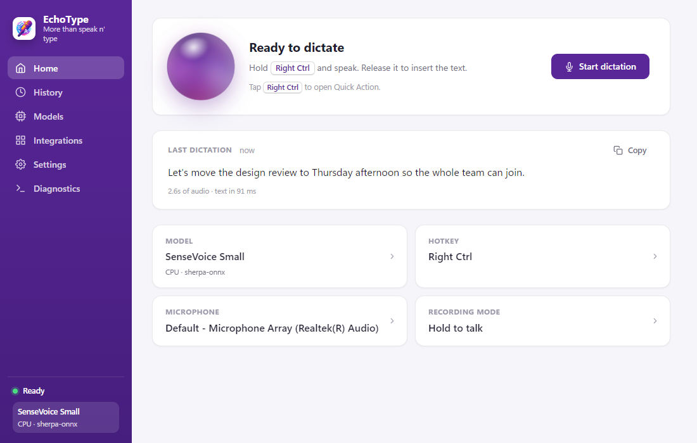
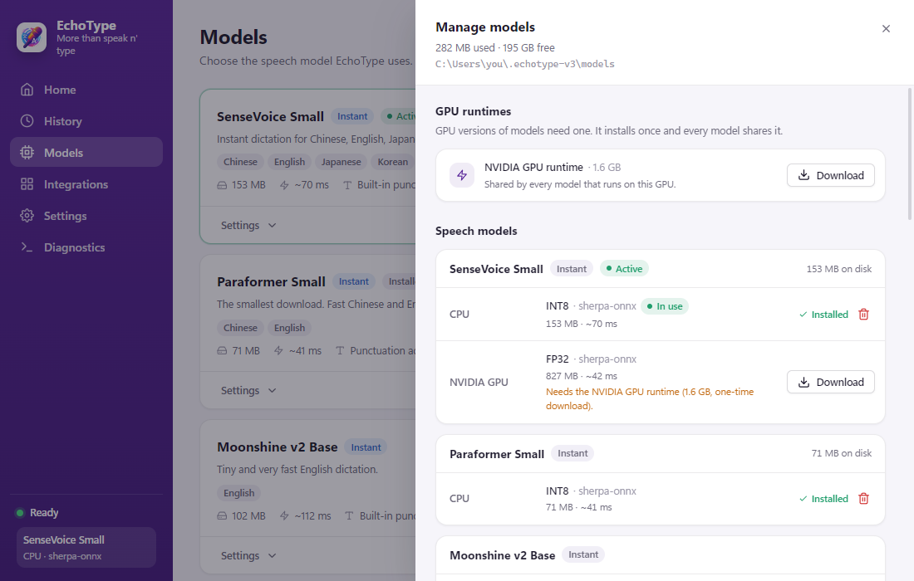
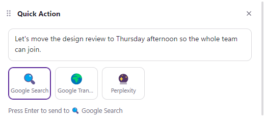
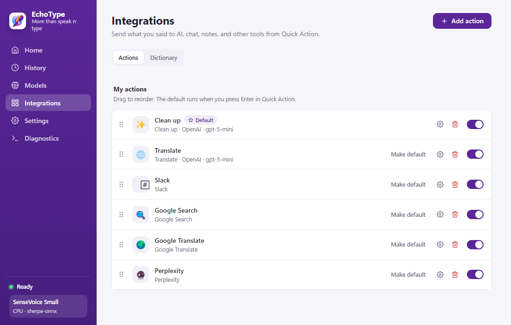
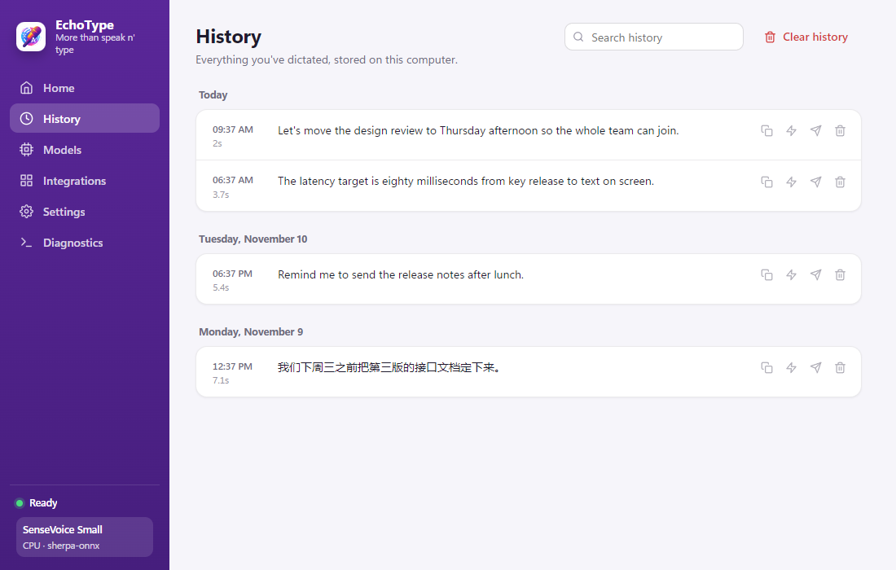
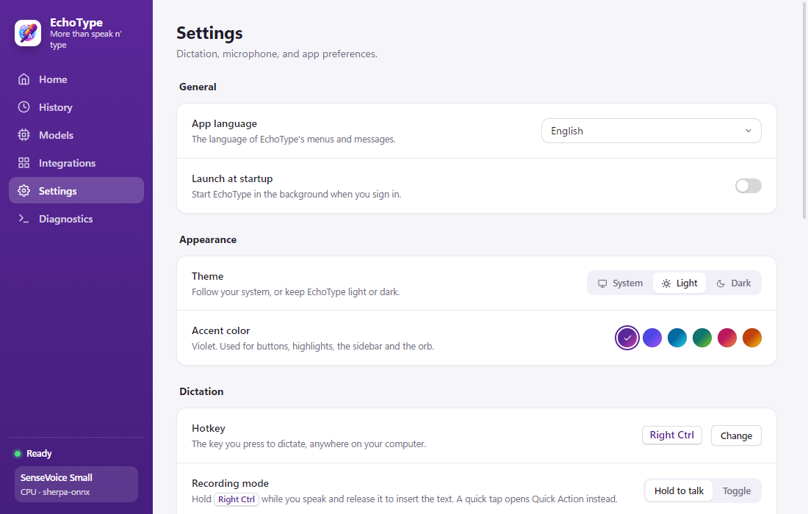
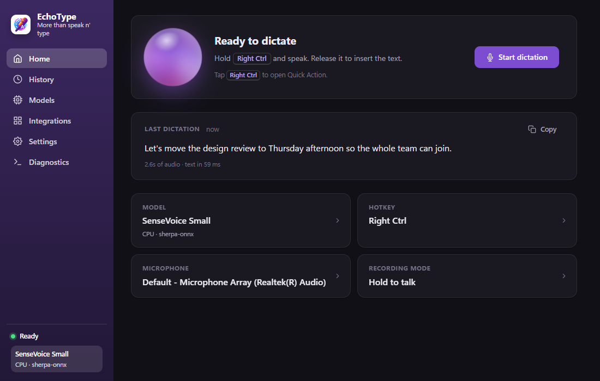

<div align="center">


# EchoType

**Hold a key, speak, let go. Your words appear where you type.**

Local speech-to-text for Windows, macOS and Linux.

[Download v3.0.0](https://github.com/ljyou001/echotype/releases/tag/v3.0.0) · [Quick start](#quick-start) · [Build from source](#build-from-source) · [Release notes](RELEASE_NOTES_v3.0.0.md)

English | [简体中文](README_ZH.md)

</div>



## What it does

- **Hold to talk, release to paste.** Hold your hotkey, speak, and let go. The text lands at your cursor, in any app.
- **Tap for Quick Action.** Tap the same key to open your last text in a small window. Clean it up with AI, send it to Slack, or search for it.
- **Fast.** With SenseVoice or Paraformer on CPU, text appears 0–10 ms after you release the key if you pause briefly first, and in under 100 ms if you release the instant you stop talking (measured on an i9-13980HX).
- **Accurate regardless of timing.** Dictation gives the same text as transcribing the whole recording. Numbers come out as digits ("9点", "50 pieces").
- **Private.** Speech recognition runs on your computer. Nothing is sent anywhere unless you run an integration.

## Screenshots

| Models and the Model Manager | Quick Action |
|:---:|:---:|
|  |  |
| **Integrations** | **History** |
|  |  |
| **Settings** | **Dark theme** |
|  |  |

## Download

Get the latest build from [GitHub Releases (v3.0.0)](https://github.com/ljyou001/echotype/releases/tag/v3.0.0).

| Platform | Files |
|---|---|
| Windows (x64, ARM64) | `EchoType-3.0.0-win-<arch>.exe` (installer) or `.zip` (portable) |
| macOS (Apple Silicon, Intel) | `EchoType-3.0.0-mac-<arch>.dmg` or `.zip` |
| Linux (x64, ARM64) | `.AppImage` or `.deb` |

`SHA256SUMS.txt` lists the checksum of every file. The Windows installer is about 165 MB; models download separately, only the ones you pick.

**The installers aren't code-signed yet.** On Windows, choose **More info → Run anyway**. On macOS, right-click the app and choose **Open** the first time.

### Known issues

- v3 has been tested on Windows x64. The macOS, Linux and ARM64 builds pass automated checks but haven't been tested on real hardware yet.
- On Linux with Wayland, the system limits global hotkeys. EchoType shows a notice when this applies.

## Quick start

1. **Install and open EchoType.**
2. **Pick a model.** Open **Models**, download one, and choose **Use this model**. SenseVoice Small is a quick first pick. **Manage models** lists every version and the optional GPU runtime.
3. **Set your hotkey.** The default is Right Ctrl (Right Option on macOS). Change it in **Settings → Dictation → Hotkey**.
4. **Dictate.** Hold the hotkey, speak, and release. Tap it to open Quick Action. Prefer press-to-start, press-to-stop? Switch **Recording mode** to **Toggle**.

## Models

The Model Manager offers 9 speech models:

- SenseVoice Small
- Paraformer Small
- Paraformer
- Qwen3 ASR 0.6B
- Qwen3 ASR 1.7B
- FireRedASR 2 AED
- Parakeet TDT 0.6B v3
- Moonshine v2 Base (English)
- Whisper Large v3 Turbo

A punctuation model installs automatically when a model needs one. Downloads are checksum-verified and resume where they left off.

**CPU by default, GPU when you want it.** Every model runs on CPU out of the box. GPU acceleration is an optional one-time download: NVIDIA CUDA on Windows and Linux x64, and Vulkan on Windows and Linux. The Apple Silicon build includes Metal acceleration for Qwen3.

Punctuation and language settings live with each model. Punctuation follows the language you speak, or you can pick one style.

## Quick Action and integrations

Tap the hotkey to open Quick Action with your last text, then pick an action. Press Enter to run your default one.

- **AI transforms:** clean up, translate, rewrite as an email or a chat message, make a bullet list, or ask AI. Works with OpenAI, Anthropic Claude, Google Gemini, DeepSeek, Qwen, Kimi, Zhipu GLM and OpenRouter, or with local models via Ollama, LM Studio or a llama.cpp server.
- **Send** to Slack, Discord, Feishu/Lark, Todoist, Obsidian, a webhook, Claude Code or Codex CLI.
- **Open** in Google, Bing, Baidu, ChatGPT, Claude, Perplexity, Gemini, Qwen, Doubao, ERNIE Bot, Google Translate, DeepL, Youdao or any web page.

Set up and reorder actions on the **Integrations** page.

## Privacy

- Speech recognition runs entirely on your computer.
- Your text leaves your computer only when you run an integration, and only goes to the service that integration names.
- API keys are encrypted with your system's secure storage.
- History stays on your computer. You can search it, copy from it, or clear it any time.

## Your data

EchoType v3 keeps everything in `~/.echotype-v3`: settings, history, models, GPU runtimes and logs.

**Upgrading from v2?** On first launch, v3 imports your v2 settings and integrations. It never changes the v2 folder `~/.echotype`. v2 models use a different format, so download the ones you want again from the Model Manager.

## Build from source

You need Node.js 20 or later, npm, and Rust 1.85 or later.

```bash
git clone https://github.com/ljyou001/echotype.git
cd echotype
```

Build the engine. The first build downloads about 1 GB of sherpa-onnx libraries.

```bash
cd engine
cargo build --release
cd ..
```

Run the app in development mode. It starts the engine from `engine/target/release`.

```bash
cd frontend
npm install
node node_modules/electron/install.js
npm run dev
```

npm 11 skips dependency install scripts, so `node node_modules/electron/install.js` downloads the Electron binary.

- `npm run dev:mock` runs the app on a mock engine, without building Rust.
- Qwen3 models run on llama.cpp. To try them in a development build, first run `bash scripts/make-pack.sh cpu <platform> target/release` in `engine/`, where `<platform>` is, for example, `win32-x64`.
- Tests: `npm run test:core` and `npm run smoke:core` in `frontend/`, and `cargo test --release` in `engine/`.
- Packaging: `npm run package` builds the Windows x64 installer locally. The other targets build on GitHub Actions ([build.yml](.github/workflows/build.yml)).

## Architecture

EchoType has three layers, and each one depends only on the next:

**UI → Core → Engine**

- **UI** (`frontend/src`): React 18 and Zustand. It renders the state Core sends and never talks to the engine.
- **Core** (`frontend/electron`): the Electron main process. It owns the dictation state machine, the hotkey, text output, settings, model installs and integrations.
- **Engine** (`engine/`): `echotype-engine`, a native Rust process built on sherpa-onnx and llama.cpp. It handles the microphone, voice activity detection, speech recognition and punctuation, and talks to Core over a local WebSocket.

Read more:

- [Architecture](design/ARCHITECTURE_V3.md) (Chinese)
- [Engine protocol](contracts/ENGINE_PROTOCOL.md)
- [Model manifest](contracts/MODEL_MANIFEST.md)
- [Integrations](design/INTEGRATIONS_V3.md) (Chinese)
- [Latency benchmarks](design/BENCHMARKS.md)

## Contributing

Contributions are welcome. Read [CONTRIBUTING.md](CONTRIBUTING.md) first. If this is your first contribution, sign the [Contributor License Agreement](CLA.md).

## License

EchoType is licensed under the **GNU Affero General Public License v3.0 or later (AGPL-3.0-or-later)**. See [LICENSE](LICENSE). Contributions are covered by the [CLA](CLA.md).

Each speech model has its own license. **Settings → About** lists every model license and open-source component.

## Acknowledgments

- [CapsWriter-Offline](https://github.com/HaujetZhao/CapsWriter-Offline), the project EchoType started from
- [sherpa-onnx](https://github.com/k2-fsa/sherpa-onnx) and [llama.cpp](https://github.com/ggml-org/llama.cpp), which power the engine
- The authors of every speech model in the Model Manager

## Support

Found a bug or have an idea? [Open an issue](https://github.com/ljyou001/echotype/issues).
