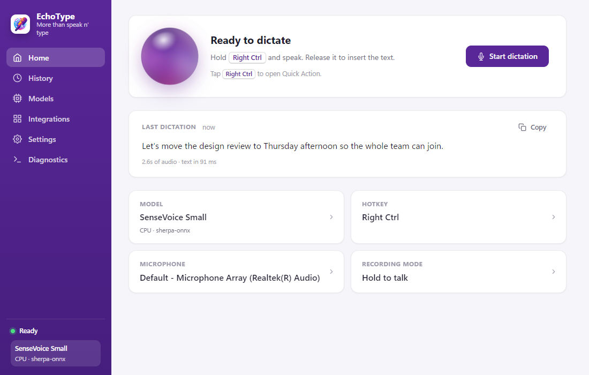
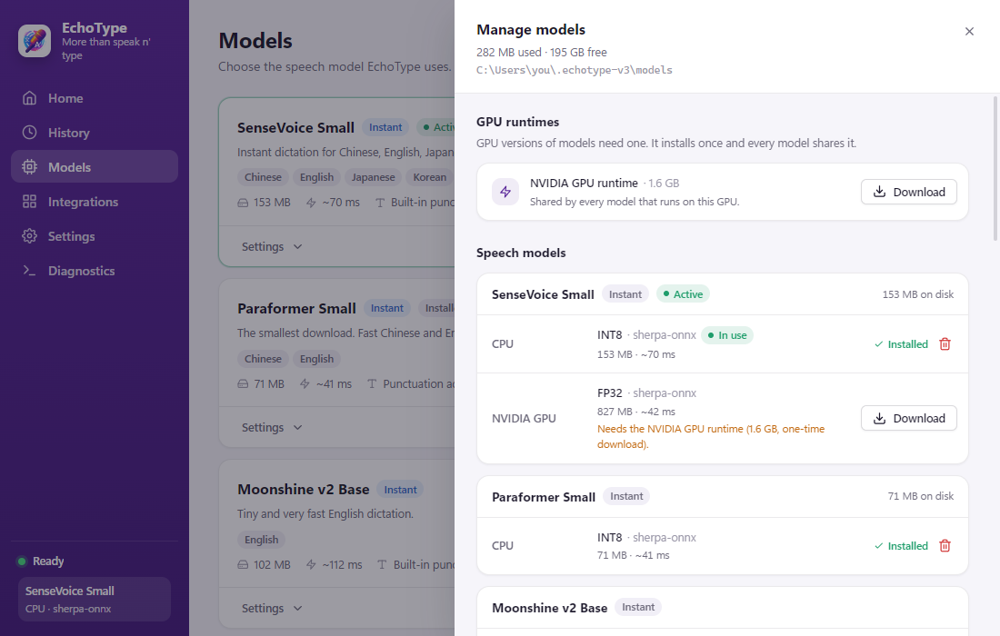
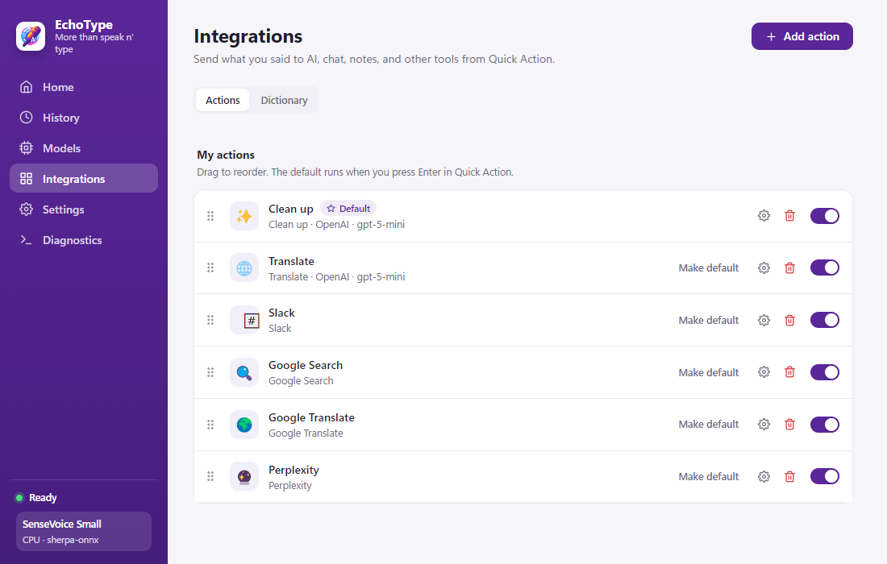
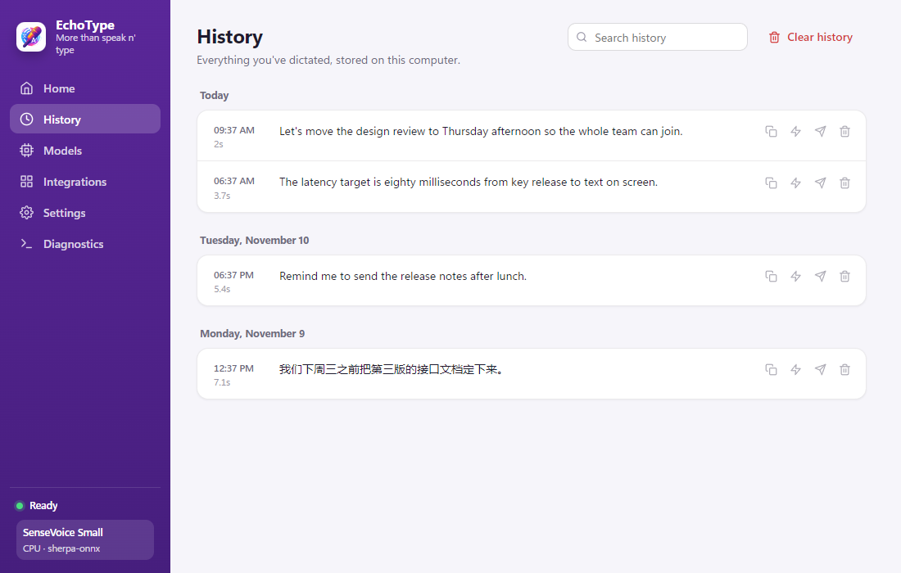
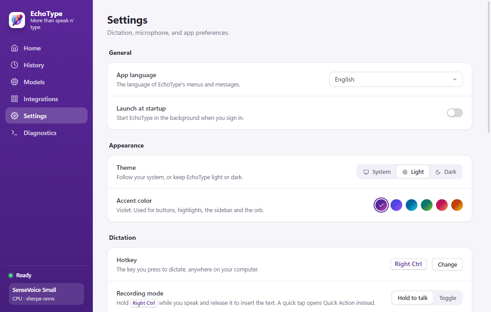
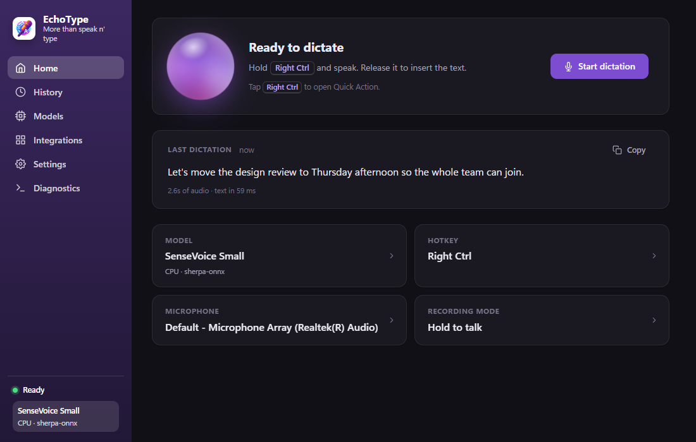

<div align="center">


# EchoType

**按住一个键说话，松开，文字就出现在你正在输入的地方。**

在本机运行的语音输入，支持 Windows、macOS 和 Linux。

[下载 v3.0.0](https://github.com/ljyou001/echotype/releases/tag/v3.0.0) · [快速上手](#快速上手) · [从源码构建](#从源码构建) · [更新日志](RELEASE_NOTES_v3.0.0.md)

[English](README.md) | 简体中文

</div>



## 能做什么

- **按住说话，松开出字。** 按住热键说话，松开后文字直接打在光标处，在哪个应用里都行。
- **轻按打开快捷操作。** 轻按同一个键，刚才说的话会出现在一个小窗口里。可以让 AI 润色、发到 Slack，或者直接拿去搜索。
- **快。** 用 CPU 跑 SenseVoice 或 Paraformer：说完稍停一下再松键，0–10 ms 出字；话音刚落就松键，也不到 100 ms（i9-13980HX 实测）。
- **准，和松键时机无关。** 按住说话的结果和整段录音转写的结果一致，数字也会自动写成阿拉伯数字（"9点"、"50 pieces"）。
- **隐私。** 语音识别全部在你的电脑上完成。只有你主动运行集成时，文字才会发出去。

## 截图

| 模型与模型管理器 | 快捷操作 |
|:---:|:---:|
|  |  |
| **集成** | **历史记录** |
|  |  |
| **设置** | **深色主题** |
|  |  |

## 下载

到 [GitHub Releases（v3.0.0）](https://github.com/ljyou001/echotype/releases/tag/v3.0.0) 下载最新版本。

| 平台 | 文件 |
|---|---|
| Windows（x64、ARM64） | `EchoType-3.0.0-win-<arch>.exe`（安装包）或 `.zip`（免安装） |
| macOS（Apple Silicon、Intel） | `EchoType-3.0.0-mac-<arch>.dmg` 或 `.zip` |
| Linux（x64、ARM64） | `.AppImage` 或 `.deb` |

每个文件的校验值见 `SHA256SUMS.txt`。Windows 安装包约 165 MB，模型另外下载，只下你选的那几个。

**安装包还没有代码签名。** Windows 上点**更多信息 → 仍要运行**；macOS 上第一次打开时，右键点应用，选**打开**。

### 已知问题

- v3 目前只在 Windows x64 上实测过。macOS、Linux 和 ARM64 版本通过了自动检查，但还没有在真机上测试。
- Linux 的 Wayland 环境下，系统会限制全局热键，遇到时应用会给出提示。

## 快速上手

1. **安装并打开 EchoType。**
2. **选一个模型。** 打开**模型**页，下载一个，再点**使用此模型**。第一次用可以先选 SenseVoice Small。**管理模型**里能看到每个模型的所有版本，以及可选的 GPU 运行库。
3. **设置热键。** 默认是右 Ctrl（macOS 上是右 Option），可以在**设置 → 听写 → 热键**里修改。
4. **开始听写。** 按住热键说话，松开出字；轻按一下打开快捷操作。想按一下开始、再按一下结束？把**录音方式**改成**单击切换**。

## 模型

模型管理器提供 9 个语音模型：

- SenseVoice Small
- Paraformer Small
- Paraformer
- Qwen3 ASR 0.6B
- Qwen3 ASR 1.7B
- FireRedASR 2 AED
- Parakeet TDT 0.6B v3
- Moonshine v2 Base（英文）
- Whisper Large v3 Turbo

需要标点模型的会自动装上。下载会校验文件完整性，中断后可以接着下。

**默认用 CPU，想快再加 GPU。** 所有模型装好就能用 CPU 跑。GPU 加速是可选的一次性下载：Windows 和 Linux x64 支持 NVIDIA CUDA，Windows 和 Linux 支持 Vulkan。Apple Silicon 版内置 Qwen3 的 Metal 加速。

标点和语言设置放在各个模型里。标点跟着你说的语言走，也可以手动固定一种。

## 快捷操作与集成

轻按热键打开快捷操作，里面是你刚才说的话，选一个动作就行；按回车运行默认动作。

- **AI 改写**：整理、翻译、改写成邮件或聊天消息、整理成要点，或者直接问 AI。支持 OpenAI、Anthropic Claude、Google Gemini、DeepSeek、通义千问、Kimi、智谱 GLM、OpenRouter，也支持通过 Ollama、LM Studio 或 llama.cpp server 运行的本地模型。
- **发送**到 Slack、Discord、飞书、Todoist、Obsidian、Webhook、Claude Code 或 Codex CLI。
- **打开**：Google、必应、百度、ChatGPT、Claude、Perplexity、Gemini、通义千问、豆包、文心一言、Google 翻译、DeepL、有道翻译，或任意网页。

在**集成**页添加动作、调整顺序。

## 隐私

- 语音识别全部在你的电脑上完成。
- 只有你运行某个集成时，文字才会离开电脑，而且只发给这个集成写明的服务。
- API key 用系统的安全存储加密保存。
- 历史记录只存在你的电脑上，可以随时搜索、复制或清空。

## 你的数据

EchoType v3 的所有数据都放在 `~/.echotype-v3`：设置、历史记录、模型、GPU 运行库和日志。

**从 v2 升级？** 第一次启动时，v3 会导入你 v2 的设置和集成，但从不修改 v2 的目录 `~/.echotype`。v2 的模型格式不同，请在模型管理器里重新下载需要的模型。

## 从源码构建

需要 Node.js 20 及以上、npm，以及 Rust 1.85 及以上。

```bash
git clone https://github.com/ljyou001/echotype.git
cd echotype
```

先编译引擎。第一次编译会下载约 1 GB 的 sherpa-onnx 库。

```bash
cd engine
cargo build --release
cd ..
```

以开发模式运行应用。它会拉起 `engine/target/release` 下的引擎。

```bash
cd frontend
npm install
node node_modules/electron/install.js
npm run dev
```

npm 11 默认不跑依赖的安装脚本，所以要用 `node node_modules/electron/install.js` 下载 Electron。

- `npm run dev:mock` 用模拟引擎运行应用，不用编译 Rust。
- Qwen3 模型跑在 llama.cpp 上。想在开发版里试，先在 `engine/` 下运行 `bash scripts/make-pack.sh cpu <platform> target/release`，`<platform>` 例如 `win32-x64`。
- 测试：在 `frontend/` 下运行 `npm run test:core` 和 `npm run smoke:core`，在 `engine/` 下运行 `cargo test --release`。
- 打包：`npm run package` 在本机打出 Windows x64 安装包。其余平台在 GitHub Actions 上构建（[build.yml](.github/workflows/build.yml)）。

## 架构

EchoType 分三层，每一层只依赖下一层：

**UI → Core → Engine**

- **UI**（`frontend/src`）：React 18 + Zustand。只渲染 Core 推来的状态，从不直接连引擎。
- **Core**（`frontend/electron`）：Electron 主进程。听写状态机、热键、文字输出、设置、模型安装和集成都在这里。
- **Engine**（`engine/`）：`echotype-engine`，基于 sherpa-onnx 和 llama.cpp 的原生 Rust 进程。负责麦克风、语音活动检测、语音识别和标点，通过本地 WebSocket 和 Core 通信。

延伸阅读：

- [架构设计](design/ARCHITECTURE_V3.md)
- [引擎协议](contracts/ENGINE_PROTOCOL.md)（英文）
- [模型清单规范](contracts/MODEL_MANIFEST.md)（英文）
- [集成方案](design/INTEGRATIONS_V3.md)
- [延迟基准](design/BENCHMARKS.md)（英文）

## 参与贡献

欢迎贡献。请先阅读 [CONTRIBUTING.md](CONTRIBUTING.md)；第一次贡献时，请签署[贡献者许可协议](CLA.md)。

## 许可证

EchoType 以 **GNU Affero General Public License v3.0 or later（AGPL-3.0-or-later）** 开源，详见 [LICENSE](LICENSE)。贡献受 [CLA](CLA.md) 约束。

每个语音模型都有自己的许可证。**设置 → 关于**里列出了所有模型的许可证和开源组件。

## 致谢

- [CapsWriter-Offline](https://github.com/HaujetZhao/CapsWriter-Offline)：EchoType 的起点
- [sherpa-onnx](https://github.com/k2-fsa/sherpa-onnx) 和 [llama.cpp](https://github.com/ggml-org/llama.cpp)：引擎的基础
- 模型管理器里每个语音模型的作者

## 反馈

发现问题或有想法？欢迎[提交 Issue](https://github.com/ljyou001/echotype/issues)。
